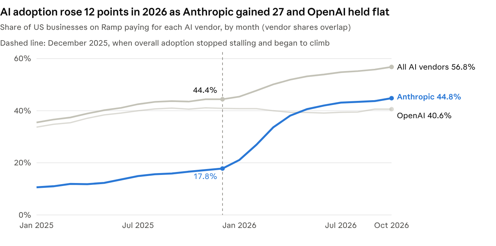

# Business AI Adoption Jumped 12 Points in 2026

**Question:** How did US businesses' AI buying change in 2026, and why?

**Finding:** The share of US businesses paying for AI rose from **44.4% (Dec 2025) to 56.8% (Oct 2026)** after stalling in late 2025. Over the same months, Anthropic's share went from **17.8% to 44.8%** and passed OpenAI in May 2026, while OpenAI's held near **40%**.



📄 **Full write-up:** [AI_Adoption_2026_report.pdf](AI_Adoption_2026_report.pdf) · [Handshake AI Showcase](https://app.joinhandshake.com/ai-showcase/projects/3819322)

## Does the trend hold up?

Yes. The 2026 jump appears for every company size, after all three were flat from August to December 2025.

| Company size | Dec 2025 | Oct 2026 | Change |
|---|---|---|---|
| Small | 39.1% | 51.2% | +12.1 pts |
| Medium | 48.2% | 63.2% | +15.1 pts |
| Large | 53.3% | 66.7% | +13.4 pts |

## Why did it happen? Two explanations, tested

1. **New adopters:** businesses that paid for no AI started paying in 2026. This can explain at most the 12.4-point rise in overall adoption.
2. **Existing AI users added a second vendor:** Anthropic gained 27.0 points, more than twice the overall rise. So **at least 14.6 points** of its gain came from businesses already paying for AI. OpenAI's share did not fall, so these businesses *added* a vendor rather than switching.

**Overlap check:** for any two groups, `both ≥ OpenAI share + Anthropic share − overall share`. At least **28.6%** of businesses paid both vendors in Oct 2026, up from at least **14.3%** in Dec 2025.

**Still unresolved:** which vendor the new adopters chose, and *why* buying changed (product launches, pricing, or Ramp's own customer mix). The data cannot tell these apart.

## So what

AI buying is becoming multi-vendor. Finance and IT teams should budget for more than one AI subscription per team. For AI vendors, most 2026 growth came from winning businesses that already use a rival.

## Repository

| Path | What it is |
|---|---|
| `AI_Adoption_2026_report.pdf` | The full write-up with chart, robustness check and explanations |
| `analysis.py` | Reproduces every number above and redraws the chart |
| `ai_adoption_by_vendor_monthly.csv` | Monthly share of businesses paying for any AI tool, OpenAI and Anthropic (Jan 2025 to Oct 2026) |
| `ai_adoption_by_size.csv` | AI adoption by company size, Dec 2025 and Oct 2026 |
| `ai_adoption_chart.png`, `ai_adoption_chart_matplotlib.png` | Charts |

```bash
pip install pandas matplotlib
python analysis.py
```

## Data and limits

- Source: **Ramp AI Index** via the free Ramp Data connector (Ramp corporate card and bill-pay data, 50,000+ US businesses). Pulled November 19, 2026.
- Only spending through Ramp is counted; free tiers and tools paid another way are missed.
- Vendor shares overlap, because one business can pay several vendors.
- Ramp reports no Google data after June 2023, so Google is left out.

## Skills shown

Data analysis · statistical reasoning · robustness testing · competing-hypothesis evaluation · data storytelling · Python (pandas, matplotlib)

---
Built by **Pooja Shah** as part of Handshake AI Skills Studio · [LinkedIn](https://www.linkedin.com/in/drpoojashah)
